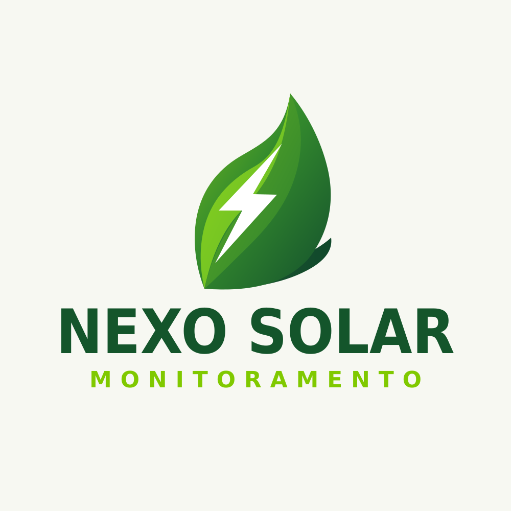
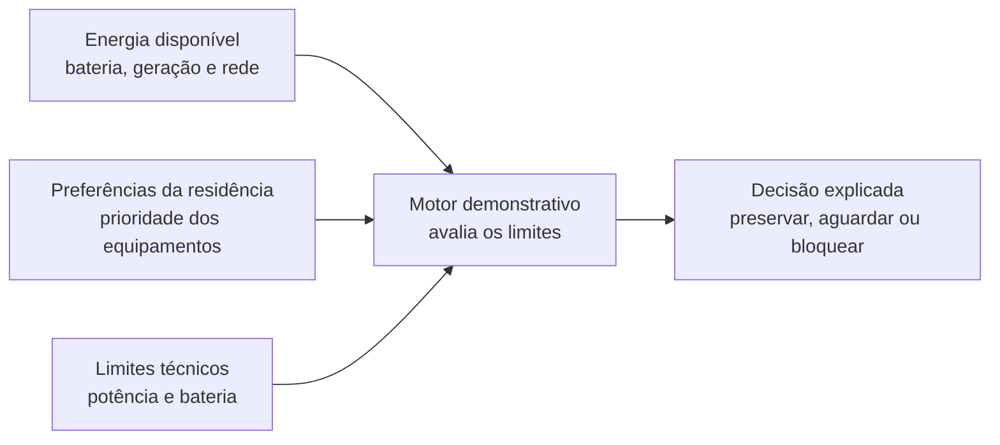
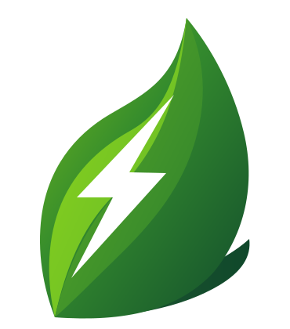
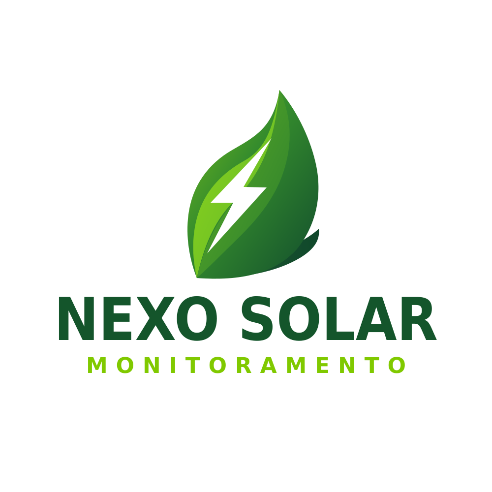

# Nexo Solar

Protótipo demonstrativo de uma experiência para gestão de energia residencial. O Nexo ajuda a visualizar a disponibilidade de energia, organizar equipamentos por prioridade e entender por que uma carga pode continuar ligada ou aguardar.

  

> **Importante:** esta é uma demonstração front-end. Não existe conexão com inversores, baterias, tomadas, serviços de autenticação ou equipamentos físicos.

## Visão geral

A interface combina uma página institucional com uma demonstração interativa de decisões energéticas. A experiência foi desenhada para apresentar as informações de forma progressiva: primeiro o conceito, depois o fluxo de decisão e, por fim, detalhes sobre prioridades, limites e segurança.

### O que a experiência demonstra

- Um resumo de bateria, potência disponível e cargas preservadas.
- Uma animação interativa de partículas no topo da página: começa em **NEXO**, espalha-se com o movimento do cursor e alterna entre **SOLAR** e **NEXO**.
- Um fluxo visual que relaciona energia disponível, preferências pessoais e limites técnicos.
- Cartões explicativos para prioridades, capacidade e justificativa das decisões.
- A navegação fixa translúcida, que muda de aparência ao rolar a página.
- Animações de entrada nas seções, respeitando a configuração de movimento reduzido do dispositivo.
- Uma área demonstrativa com painel, equipamentos, regras, simulador, histórico e configurações.
- Um exemplo local de interpretação de comandos de voz; não usa reconhecimento de voz nem envia dados a um servidor.

### Fluxo conceitual da decisão

## Imagens da marca

O símbolo e o logotipo usados pela interface ficam em `Assets/`.

  
  &nbsp;&nbsp;
  

| Arquivo | Uso |
| --- | --- |
| `Assets/Nexo-Solar-Simbolo.svg` | Símbolo ao lado do nome Nexo na navegação e em telas de acesso |
| `Assets/Nexo-Solar-Logo.svg` | Logotipo completo em vetor |
| `Assets/Nexo-Solar-Logo-preview-fundo-claro.png` | Prévia da marca em fundo claro; imagem deste README |

## Como executar

O projeto não precisa de compilação, instalação de dependências ou servidor de aplicação.

### Abrir diretamente

1. Clone ou extraia este repositório.
2. Abra a pasta no VS Code.
3. Abra `index.html` no navegador.

### Usar Live Server (recomendado durante alterações)

1. Instale a extensão **Live Server** no VS Code, se ainda não estiver instalada.
2. Clique com o botão direito em `index.html`.
3. Escolha **Open with Live Server**.

Abrir por um servidor local facilita recarregar a página enquanto os arquivos são editados. Não execute `npm install`: este protótipo não usa npm.

## Estrutura do projeto

| Caminho | Responsabilidade |
| --- | --- |
| `index.html` | Documento inicial, metadados, favicon e carregamento do CSS e JavaScript |
| `style.css` | Tokens visuais, componentes, animações, layout responsivo e estilos das telas |
| `script.js` | Estado da demonstração, renderização, navegação, animação de partículas e interações |
| `favicon.svg` | Ícone exibido na aba do navegador |
| `Assets/` | Logotipos e símbolo oficiais da marca |

## Navegação e telas

- **Página inicial:** apresentação do produto, fluxo conceitual, recursos, limites e botão para explorar a demonstração.
- **Entrar e criar acesso:** telas demonstrativas; o formulário não autentica usuários.
- **Visão geral:** resumo do estado energético calculado pela simulação.
- **Equipamentos:** lista, busca e organização das cargas demonstrativas.
- **Regras:** edição dos limites ilustrativos associados às prioridades.
- **Simulador:** aplicação de cenários predefinidos para observar decisões diferentes.
- **Histórico:** eventos registrados somente no estado da página.
- **Configurações:** dados locais da residência e exemplos de integrações ainda não conectadas.

O estado é mantido em memória no navegador e volta aos valores iniciais ao recarregar a página.

## Acessibilidade e comportamento responsivo

- O layout se adapta a telas estreitas, com navegação móvel própria nas telas internas.
- Os controles interativos são botões HTML e preservam o foco visível por teclado.
- Elementos decorativos, como o canvas da animação, não são expostos como conteúdo essencial para leitores de tela.
- Com `prefers-reduced-motion` ativado, as animações de entrada são reduzidas e as transições da marca não dependem de movimento contínuo.
- As animações de rolagem usam `IntersectionObserver` e mostram o conteúdo imediatamente caso a API não esteja disponível.

## Direção visual

A linguagem da página inicial usa ritmo editorial, bastante espaço em branco, composição assimétrica, hierarquia tipográfica e detalhes de interface discretos. As referências consultadas para essa direção foram [Estudio Bang](https://bybang.co/), [AAT Architecten](https://www.aat-architecten.be/) e [Driessen Architectuur](https://www.driessenarchitectuur.nl/). O conteúdo, a marca e os componentes são próprios do Nexo.

## Limites da demonstração

- Não há API ou back-end configurado.
- Login, cadastro, telemetria e integrações são representações visuais.
- A simulação não reflete o estado de uma instalação solar real.
- Nenhuma tomada ou carga elétrica é acionada.
- Os eventos e as alterações de configuração não são persistidos após fechar ou recarregar a página.
